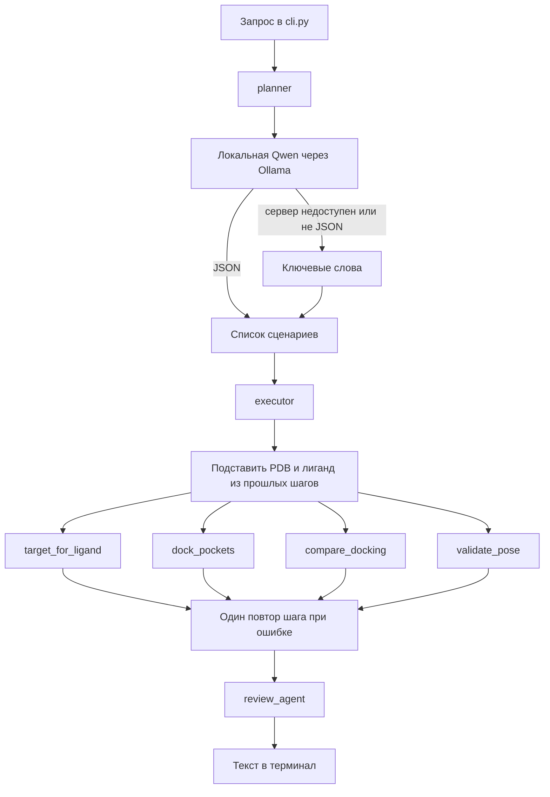
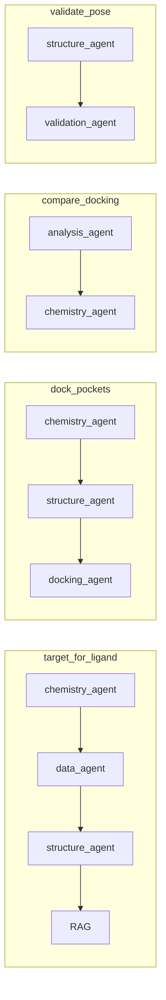

# DEARTEAM

Терминальная мультиагентная система для кейса **СИНТЕЗ №1** (drug discovery). Исследователь пишет запрос обычным языком. Планировщик собирает план из нескольких сценариев, агенты вызывают научные инструменты, а ответ состоит только из записей с происхождением: база, расчёт, предсказание или гипотеза.

Графического интерфейса нет. Всё запускается из терминала через `cli.py`.

## Локальный Qwen (Ollama)

Планировщик и текстовое объяснение идут в Qwen, если поднят Ollama. Числа по-прежнему считают RDKit, BindingDB и таблицы докинга.

```bash
ollama pull qwen2.5:7b-instruct
export DEARMO_LLM_PROVIDER=ollama
export OLLAMA_MODEL=qwen2.5:7b-instruct
python cli.py ask "Подбери белок для докинга гефитиниба и предложи PDB."
```

В ответе строка `planner` начинается с `ollama:`. Облачных моделей нет. Без сервера поставьте `DEARMO_LLM_PROVIDER=keyword` или оставьте `auto`: система коротко проверяет `http://127.0.0.1:11434` и откатывается на ключевые слова.

Докинг внутри сценария ведёт ORC: два кармана из сохранённого прогона обрабатываются параллельно, затем Writer пишет `outputs/runs/<id>/report.md`. В терминале видны `phase` и `queue`.

Docker:

```bash
docker compose up -d ollama
docker compose exec ollama ollama pull qwen2.5:7b-instruct
docker compose run --rm dearmo ask "Выполни докинг гефитиниба в структуру 4WKQ"
```

Переменные: `OLLAMA_HOST`, `OLLAMA_MODEL`, `OLLAMA_TIMEOUT_S`, `ORC_MAX_POCKETS`, `ORC_RAG_MIN_SCORE`.

## Быстрый старт

```bash
python3 -m venv .venv
source .venv/bin/activate          # Windows: .\.venv\Scripts\Activate.ps1
python -m pip install -r requirements.txt
python cli.py fetch-data           # RCSB, BindingDB, PubChem; уже скачанное можно не повторять
python cli.py ask "Подбери белок для докинга гефитиниба. Обоснуй выбор и предложи структуру из PDB."
```

Частые команды собраны в `Makefile`: `make help`, `make test`, `make demo`, `make demo-offline`, `make check`.

```bash
python -m pytest -q      # или make test
```

### AutoDock Vina

Бинарник в репозитории не хранится (каталог `tools/bin/` в `.gitignore`: сборка зависит от платформы). Без него подбор мишени и работа с базами идут как обычно, а докинг честно сообщает, что расчёт не выполнен.

Положите исполняемый файл в `tools/bin/vina` или укажите путь переменной `VINA_BIN`:

```bash
export VINA_BIN=/путь/к/vina
python -c "from tools.vina_runner import vina_binary; print(vina_binary())"
```

Сборки берутся со [страницы релизов AutoDock Vina](https://github.com/ccsb-scripps/AutoDock-Vina/releases) или ставятся через conda (`conda install -c conda-forge vina`). Проверено на версии 1.2.7.

Демо-фразы и фактические результаты лежат в [`docs/scenarios.md`](docs/scenarios.md) и [`data/demo_requests.json`](data/demo_requests.json). **Оба файла генерируются командой `python cli.py demo`** из реального прогона, поэтому разойтись с кодом не могут; `--no-docs` отключает перезапись. Команда возвращает код 1, если какой-то сценарий не дал результата. Составной запрос выполняется целиком, например: «подбери белок для гефитиниба, затем выполни докинг в 4WKQ и проверь позу».

## Что система отвечает

В терминале печатаются:

- `status` — `success`, `error`, `no_data` или `needs_clarification`;
- `planner` — `ollama:…`, если ответила локальная Qwen, иначе `keyword`;
- `plan` и `completed` — какие сценарии вошли в план и какие дошли до конца;
- таблица Evidence: `kind`, метод, значение, источник;
- `limitations` и `errors`;
- трасса агентов (номер шага, имя, действие);
- пути артефактов (`poses.csv`, heatmap, отчёт).

Оценка Vina — это `calculation`. Ki и IC50 из BindingDB — `database`. Обоснование выбора мишени или структуры, сформулированное моделью, — `hypothesis`. Эти классы не смешиваются.

Статус `partial` означает, что часть запроса выполнить не удалось: такой ответ не выдаётся за успешный, невыполненные шаги видны в `errors`.

## Схема оркестрации

Планировщик выбирает сценарии и сущности. Дальше маршрутизатор инструментов решает, какие источники и программы запускать: для подбора мишени это RDKit, BindingDB по соединению, ChEMBL по названному белку или по молекуле, затем PDB. Локальная Qwen может добавить литературу или убрать её, но не может выкинуть обязательный шаг и не подставляет числа. Если Ollama недоступен, тот же выбор делает эвристика по тексту запроса.

В коде нет ни одной зашитой молекулы, структуры или мишени: система одинаково работает с любым соединением, которое найдётся в PubChem. Принцип разделения ролей — **LLM выбирает варианты, инструменты производят числа**: модель возвращает только номер варианта из списка, собранного инструментами, и обоснование, которое попадает в Evidence как `hypothesis`.



Порядок шагов всегда один: мишень, докинг, сравнение карманов, проверка позы. В план попадают те шаги, которые распознал запрос, **плюс те, без которых они не выполнимы**.

Исполнитель сверяет вход каждого шага со списком обязательных полей и сам достраивает недостающее: на запрос «проверь позу эрлотиниба в 1M17» в плане появится `ok:dock_pockets, ok:validate_pose`, потому что позу сперва надо посчитать. Добавленные шаги видны в трассе (`resolve:<поле>`) и в отчёте по сценариям. Карта «поле → производящий шаг» лежит в `OBSERVATION_PRODUCERS` (`orchestration/scenarios.py`); поля, которые может дать только пользователь (название молекулы), помечены `None` и приводят к честному вопросу, а не к подстановке.

Внутри каждого сценария агенты такие:



| Агент | Задача | Инструменты |
| --- | --- | --- |
| `planner` | Сценарии, лиганд, PDB, пути к файлам | Локальная Qwen или ключевые слова, [`prompts/planner.txt`](prompts/planner.txt) |
| `data_agent` | Активности и литература | BindingDB, PubChem, [`data/rag/`](data/rag/) |
| `structure_agent` | Какую структуру брать | RCSB: скачанный JSON и PDB |
| `chemistry_agent` | Дескрипторы лиганда | RDKit |
| `docking_agent` | Позы и оценка Vina | Каталог `data/examples/…`, опционально бинарники |
| `analysis_agent` | Сравнение лигандов по карманам | `poses.csv`, matplotlib |
| `validation_agent` | Геометрия позы и доля пройденных проверок | PDBQT, опционально PoseBusters |
| `review_agent` | Нет ли числа в тексте без Evidence | Программные правила |

Состояние одного запроса — `WorkflowState`: план, Evidence, трасса, артефакты, ограничения, ошибки. Лимит — 40 шагов, повтор сценария — один раз.

## Четыре сценария

| ID | Пример запроса | Что обязано появиться в ответе |
| --- | --- | --- |
| `target_for_ligand` | Подбери белок для докинга гефитиниба и предложи PDB | Мишень из измерений BindingDB, PDB из поиска RCSB, дескрипторы RDKit |
| `dock_pockets` | Выполни докинг гефитиниба в 4WKQ | `vina_score`, посчитанный в этом запуске, файл позы, `report.md` |
| `compare_docking` | Сравни три лиганда в двух карманах | Лучший скор на пару лиганд×карман, heatmap, пометка, что порядок лигандов меняется |
| `validate_pose` | Проверь правдоподобность позы из этого прогона | Процент пройденных проверок, список проверок |

Подробные цепочки: [`docs/scenarios.md`](docs/scenarios.md).

Контрольный redocking бензамидина в `3PTB` лежит отдельно: `data/examples/3ptb_ben/poses.csv`, RMSD до кристалла 0.356 Å. Это эталон таблицы, а не живой запуск Vina.

## Опорный набор данных

В `data/external/` лежит заранее скачанный срез для работы без сети: структуры `3HS4` и `3PTB` с RCSB, выгрузка BindingDB и свойства PubChem по ацетазоламиду. Это **кэш реальных ответов**, а не справочник внутри кода: система обращается к нему по общему правилу поиска кэша и точно так же работает с любой другой молекулой через живые запросы.

Мишень никогда не привязана к молекуле в коде. Для ацетазоламида BindingDB отдаёт 22 измерения, и карбоангидраза II выбирается из них как измеренная мишень, а не потому, что она где-то прописана. Если в выгрузке есть только мутантная форма, перенос её Ki на дикий тип помечается классом `hypothesis`.

Молекулярная масса и logP считаются для лиганда. При смене кармана они не меняются. По карманам сравниваются оценка Vina и, если она есть, RMSD до кристалла.

## Что сделано и чего нет

| Блок | Статус | Как устроено сейчас |
| --- | --- | --- |
| Терминальный вход `cli.py ask` | Сделано | Печатает статус, Evidence, трассу, артефакты |
| Четыре сценария и составной план | Сделано | `orchestration/executor.py`, повтор шага один раз |
| Планировщик без облака | Сделано | Ключевые слова плюс транслитерация русских названий с проверкой по PubChem |
| Разрешение зависимостей шагов | Сделано | `_ensure_inputs` в `orchestration/executor.py` |
| Отсутствие хардкода молекул | Сделано | Закреплено `tests/test_no_hardcoded_chemistry.py` |
| Критик и доп. шаг | Сделано | `_critic_replan` в `orchestration/workflow.py` |
| Локальная Qwen через Ollama | Сделано | Единственная LLM: `orchestration/llm_client.py`, модель `qwen2.5:7b-instruct` |
| Облачные LLM, включая GigaChat | Не используем | Запасной путь — только ключевые слова |
| Docker Compose (Ollama + DEARMO) | Сделано | `docker-compose.yml`, `Dockerfile` |
| ORC: карман = воркер, очередь, Writer | Сделано | `orchestration/orc.py`, параллельный `asyncio.gather` |
| BindingDB по любому соединению | Сделано | Запрос по SMILES, мишень выводится из измерений |
| RCSB: поиск и метаданные | Сделано | Полнотекстовый поиск + выбор структуры моделью |
| PubChem по имени и SMILES | Сделано | Живой PUG REST, резолв произвольных молекул |
| RDKit-дескрипторы | Сделано | Масса, logP, TPSA, HBD, HBA, вращаемые связи |
| RAG | Частично | Поиск по заранее положенным JSON в `data/rag/`, не по полным статьям |
| Докинг на защите | Живой расчёт | ~3 с на пару; кеш только при совпадении `run_meta.json` |
| Живой Vina | Сделано | `tools/bin/vina` 1.2.7, `tools/live_docking.py`, запускается по умолчанию |
| Сравнение карманов и heatmap | Сделано | `outputs/analysis/vina_heatmap.png` |
| Проверка позы | Сделано базово | Файл, формат PDBQT, число атомов; PoseBusters — если пакет установлен |
| RMSD до кристалла в отчёте | Сделано для демо-таблицы | Колонка `rmsd_to_crystal` в `poses.csv` |
| ChEMBL и поиск аналогов | Сделано | Живые запросы; при недоступности API это сказано вслух |
| Веб-интерфейс | Убран | Раньше был Streamlit, сейчас только терминал |
| Нормализация солей и таутомеров | Нет | RDKit считает введённую структуру как есть |
| Автотесты | Сделано | 135 тестов: маршруты, источники, живой докинг, запрет хардкода, golden RMSD 3PTB |

## Каталоги

```
cli.py                         запрос и скачивание данных
agents/                        роли: план, данные, структура, химия, докинг, анализ, валидация, проверка
orchestration/                 workflow, executor, ORC, сценарии, клиент Ollama
tools/                         BindingDB, PDB, PubChem, RDKit, RAG, графики, обёртки Vina и P2Rank
models/                        ResearchRequest, ResearchResult, Evidence, строки poses.csv
prompts/                       текст планировщика
data/external/                 скачанные PDB, BindingDB, PubChem
data/examples/acetazolamide/   отчёт, poses.csv и позы для демо
data/examples/3ptb_ben/        контроль RMSD
data/cache/                    ручной запасной кеш, если скачанных файлов нет
data/rag/                      короткие выдержки для сценария мишени
outputs/                       графики и будущие живые прогоны, в git не коммитится
docs/                          сценарии и архитектура
tests/                         pytest
```

## Данные и модели

Повторно забрать источники:

```bash
python cli.py fetch-data
```

Скрипт `tools/dataset_fetch.py` пишет:

- `https://files.rcsb.org/download/3HS4.pdb` и `3PTB.pdb`, плюс JSON записи с `data.rcsb.org`;
- PubChem: свойства опорных соединений;
- BindingDB `getTargetByCompound` по SMILES `CC(=O)Nc1nnc(S(N)(=O)=O)s1`.

Языковая модель только локальная. Демо-фразы проходят и без неё, на ключевых словах. Qwen выбирает сценарий и может пересказать уже собранные факты. Она не имеет права добавлять числа, которых нет в Evidence: это проверяет `review_agent`.

Живой докинг, если на машине есть бинарники:

```bash
export VINA_BIN=vina
export P2RANK_BIN=prank
python -m tools.docking_pipeline --pdb 3HS4 --smiles "CC(=O)NC1=NN=C(S1)S(=O)(=O)N" --output outputs/docking_run --live
```

Докинг в `cli.py ask` считается **вживую по умолчанию** (около 3 секунд на пару). `DOCKING_LIVE=0` переключает на сохранённый прогон, но он берётся только если его `run_meta.json` совпадает и по структуре, и по лиганду — позы другой молекулы не подставляются никогда.

## Как читать ответ на защите

1. Мишень. Возьмите **любую** молекулу, которой нет в репозитории. В таблице появятся живой CID из PubChem, измерения BindingDB, обоснование выбора мишени от модели (строка `target_choice_rationale`, класс `hypothesis`) и структура из поиска RCSB.
2. Сравнение карманов. Три лиганда, два кармана, порядок по Vina меняется. Масса и logP от кармана не зависят.
3. Проверка позы. Процент пройденных геометрических проверок.
4. Докинг. Показать `outputs/runs/<id>/report.md` этого же запуска: оценка Vina посчитана на сцене, а не прочитана из файла.
5. Честность. Попросить разобрать ответ: `review_agent` проверяет, что каждое число из текста существует в Evidence **и привязано к своей величине**. Если модель напишет «оценка Vina 2.5», взяв 2.5 из IC50, пересказ будет заменён на перечисление измерений.

Ожидаемый ответ и фактический для каждого сценария расписаны в [`docs/scenarios.md`](docs/scenarios.md). Схема ролей — в [`docs/architecture.md`](docs/architecture.md).

## Ограничения, которые система говорит вслух

- Дескрипторы RDKit не являются активностью, ADMET, эффективностью или безопасностью.
- Оценка Vina не является экспериментальной аффинностью.
- `rmsd_to_first_pose` — расстояние до первой расчётной позы Vina. `rmsd_to_crystal` — до экспериментального лиганда. В отчёте это разные колонки.
- RAG — несколько заранее сохранённых абзацев, не поиск по всей литературе.
- Выгрузка BindingDB для этого SMILES короткая: 22 хита, без Ki дикого типа CA II.
- Соли, заряды и таутомеры не нормализуются.
