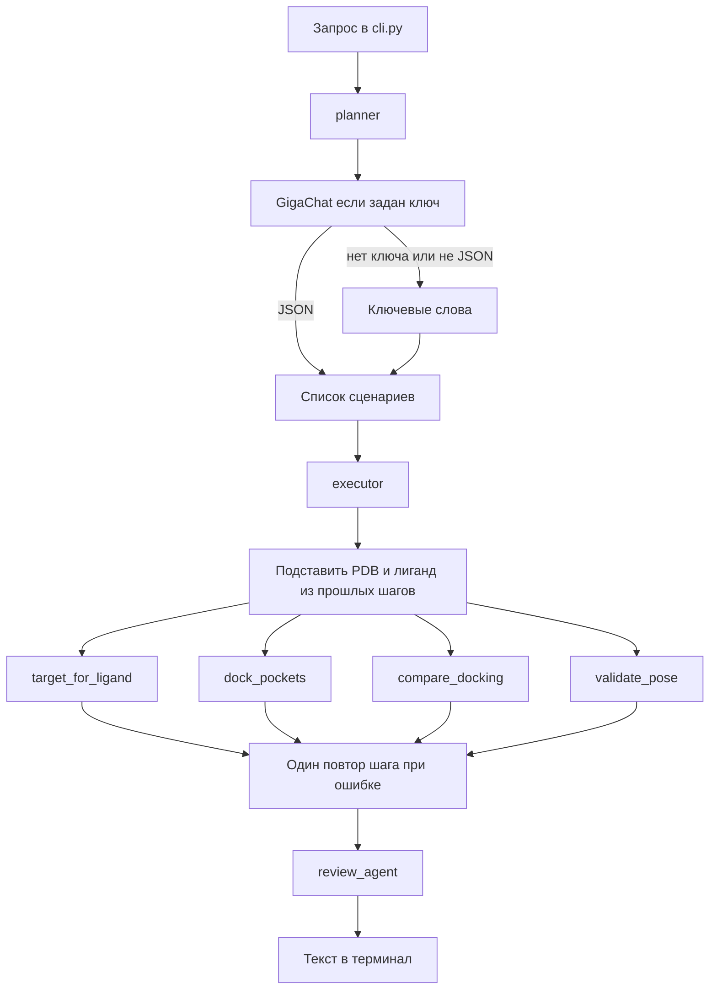
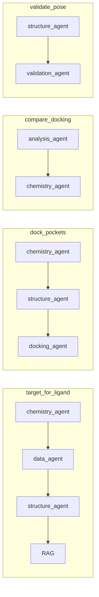

# DEARTEAM

Терминальная мультиагентная система для кейса **СИНТЕЗ №1** (drug discovery). Исследователь пишет запрос обычным языком. Планировщик собирает план из нескольких сценариев, агенты вызывают научные инструменты, а ответ состоит только из записей с происхождением: база, расчёт, предсказание или гипотеза.

Графического интерфейса нет. Всё запускается из терминала через `cli.py`.

## Быстрый старт

```bash
python3 -m venv .venv
source .venv/bin/activate          # Windows: .\.venv\Scripts\Activate.ps1
python -m pip install -r requirements.txt
python cli.py fetch-data           # RCSB, BindingDB, PubChem; уже скачанное можно не повторять
python cli.py ask "Подбери белок для докинга ацетазоламида. Обоснуй выбор и предложи структуру из PDB."
```

Проверки:

```bash
python -m pytest -q
```

Демо-фразы лежат в [`data/demo_requests.json`](data/demo_requests.json). Составной запрос выполняется целиком, например: «подбери белок, затем выполни докинг в 3HS4 и проверь позу».

## Что система отвечает

В терминале печатаются:

- `status` — `success`, `error`, `no_data` или `needs_clarification`;
- `planner` — `gigachat`, если сработал облачный вызов, иначе `keyword`;
- `plan` и `completed` — какие сценарии вошли в план и какие дошли до конца;
- таблица Evidence: `kind`, метод, значение, источник;
- `limitations` и `errors`;
- трасса агентов (номер шага, имя, действие);
- пути артефактов (`poses.csv`, heatmap, отчёт).

Оценка Vina — это `calculation`. Ki и IC50 из BindingDB — `database`. Перенос Ki мутанта CA2 на белок дикого типа помечается как `hypothesis`. Эти три класса не смешиваются.

## Схема оркестрации

Планировщик не крутит свободный цикл «подумал → вызвал инструмент». Он только выбирает сценарии и сущности. Дальше исполнитель идёт по фиксированному научному порядку и на каждом шаге вызывает уже написанную цепочку агентов. Числа считают инструменты, не модель.



Порядок шагов всегда один: мишень, докинг, сравнение карманов, проверка позы. В план попадают только те шаги, которые распознал запрос. Если для докинга ещё нет PDB, исполнитель берёт его из рекомендации предыдущего шага.

Внутри каждого сценария агенты такие:



| Агент | Задача | Инструменты |
| --- | --- | --- |
| `planner` | Сценарии, лиганд, PDB, пути к файлам | GigaChat или ключевые слова, [`prompts/planner.txt`](prompts/planner.txt) |
| `data_agent` | Активности и литература | BindingDB, PubChem, [`data/rag/`](data/rag/) |
| `structure_agent` | Какую структуру брать | RCSB: скачанный JSON и PDB |
| `chemistry_agent` | Дескрипторы лиганда | RDKit |
| `docking_agent` | Позы и оценка Vina | Каталог `data/examples/…`, опционально бинарники |
| `analysis_agent` | Сравнение лигандов по карманам | `poses.csv`, matplotlib |
| `validation_agent` | Геометрия позы и доля пройденных проверок | PDBQT, опционально PoseBusters |
| `review_agent` | Нет ли числа в тексте без Evidence | Программные правила |

Состояние одного запроса — `WorkflowState`: план, Evidence, трасса, артефакты, ограничения, ошибки. Лимит — 40 шагов, повтор сценария — один раз.

## Четыре сценария

| ID | Пример запроса | Что обязано появиться в ответе |
| --- | --- | --- |
| `target_for_ligand` | Подбери белок для докинга ацетазоламида и предложи PDB | CA II, PDB `3HS4`, строки BindingDB, дескрипторы RDKit, выдержка RAG |
| `dock_pockets` | Выполни докинг ацетазоламида в 3HS4 | Лучший `vina_score` из сохранённого прогона, файл позы, `report.md` |
| `compare_docking` | Сравни три лиганда в двух карманах | Лучший скор на пару лиганд×карман, heatmap, пометка, что порядок лигандов меняется |
| `validate_pose` | Проверь правдоподобность позы ацетазоламида в 3HS4 | Процент пройденных проверок, список проверок |

Подробные цепочки: [`docs/scenarios.md`](docs/scenarios.md).

Контрольный redocking бензамидина в `3PTB` лежит отдельно: `data/examples/3ptb_ben/poses.csv`, RMSD до кристалла 0.356 Å. Это эталон таблицы, а не живой запуск Vina.

## Стенд на ацетазоламиде

Рекомендуемая структура — **3HS4**, человеческая карбоангидраза II с ацетазоламидом, разрешение 1.1 Å, PubMed 19851004. Файл структуры скачан с RCSB.

BindingDB по SMILES ацетазоламида отдаёт 22 измерения. Среди них нет Ki дикого типа человеческой CA II. Ближайшая строка — мутант CA2. Система всё равно предлагает 3HS4, потому что это экспериментальный комплекс с тем же лигандом, а перенос Ki мутанта помечает гипотезой. Минимальная Ki другой изоформы (CA3, 3.1 нМ) мишенью не выбирается.

Молекулярная масса и logP считаются для лиганда. При смене кармана они не меняются. По карманам сравниваются оценка Vina и, если она есть, RMSD до кристалла.

## Что сделано и чего нет

| Блок | Статус | Как устроено сейчас |
| --- | --- | --- |
| Терминальный вход `cli.py ask` | Сделано | Печатает статус, Evidence, трассу, артефакты |
| Четыре сценария и составной план | Сделано | `orchestration/executor.py`, повтор шага один раз |
| Планировщик без облака | Сделано | Ключевые слова в `orchestration/scenarios.py` |
| GigaChat как планировщик и автор текста | Подключено, не обязательно | Нужен `GIGACHAT_CREDENTIALS`; при ошибке тихий откат на ключевые слова |
| Локальная модель (Ollama и аналоги) | Нет | Клиент заточен под пакет `gigachat` |
| Docker | Нет | Запуск только через venv |
| BindingDB по ацетазоламиду | Сделано | 22 строки в `data/external/bindingdb/` |
| RCSB 3HS4 и 3PTB | Сделано | PDB и JSON записи в `data/external/rcsb/` |
| PubChem CID 1986 | Сделано | `data/external/pubchem/acetazolamide.json` |
| RDKit-дескрипторы | Сделано | Масса, logP, TPSA, HBD, HBA, вращаемые связи |
| RAG | Частично | Поиск по заранее положенным JSON в `data/rag/`, не по полным статьям |
| Докинг на защите | Сделано как чтение кеша | `data/examples/acetazolamide/` |
| Живые P2Rank и Vina | Каркас | `tools/p2rank_runner.py`, `tools/vina_runner.py`, CLI `tools/docking_pipeline.py --live` |
| Сравнение карманов и heatmap | Сделано | `outputs/analysis/vina_heatmap.png` |
| Проверка позы | Сделано базово | Файл, формат PDBQT, число атомов; PoseBusters — если пакет установлен |
| RMSD до кристалла в отчёте | Сделано для демо-таблицы | Колонка `rmsd_to_crystal` в `poses.csv` |
| ChEMBL и поиск аналогов | Не сделано | `tools/chembl_client.py` и `tools/ranking.py` остаются заглушками |
| Веб-интерфейс | Убран | Раньше был Streamlit, сейчас только терминал |
| Нормализация солей и таутомеров | Нет | RDKit считает введённую структуру как есть |
| Автотесты | Сделано | Маршруты, CSV, скачанные базы, геометрия позы, golden RMSD 3PTB |

## Каталоги

```
cli.py                         запрос и скачивание данных
agents/                        роли: план, данные, структура, химия, докинг, анализ, валидация, проверка
orchestration/                 workflow, executor, сценарии, состояние, клиент GigaChat
tools/                         BindingDB, PDB, PubChem, RDKit, RAG, графики, обёртки Vina и P2Rank
models/                        ResearchRequest, ResearchResult, Evidence, строки poses.csv
prompts/                       текст планировщика
data/external/                 скачанные PDB, BindingDB, PubChem
data/examples/acetazolamide/   отчёт, poses.csv и позы для демо
data/examples/3ptb_ben/        контроль RMSD
data/cache/                    ручной запасной кеш, если скачанных файлов нет
data/rag/                      короткие выдержки для сценария мишени
outputs/                       графики и будущие живые прогоны, в git не коммитится
docs/                          сценарии и архитектура
tests/                         pytest
```

## Данные и модели

Повторно забрать источники:

```bash
python cli.py fetch-data
```

Скрипт `tools/dataset_fetch.py` пишет:

- `https://files.rcsb.org/download/3HS4.pdb` и `3PTB.pdb`, плюс JSON записи с `data.rcsb.org`;
- PubChem: свойства ацетазоламида;
- BindingDB `getTargetByCompound` по SMILES `CC(=O)Nc1nnc(S(N)(=O)=O)s1`.

Облачная модель необязательна. Демо-фразы проходят на ключевых словах.

```bash
export GIGACHAT_CREDENTIALS="<authorization key>"
export GIGACHAT_MODEL="GigaChat-Pro"          # по умолчанию GigaChat
export GIGACHAT_VERIFY_SSL_CERTS=false        # сертификат НУЦ Минцифры
```

Ключ в репозиторий не кладётся. Модель выбирает сценарий и может пересказать уже собранные факты. Она не имеет права добавлять числа, которых нет в Evidence: это проверяет `review_agent`.

Живой докинг, если на машине есть бинарники:

```bash
export VINA_BIN=vina
export P2RANK_BIN=prank
python -m tools.docking_pipeline --pdb 3HS4 --smiles "CC(=O)NC1=NN=C(S1)S(=O)(=O)N" --output outputs/docking_run --live
```

Без `--live` команда завершается с кодом 2 и ничего не считает. Переменная `DOCKING_LIVE=1` в обычном `cli.py ask` сама по себе PDBQT не готовит: агент докинга всё равно читает сохранённый пример и пишет об этом в ограничениях.

## Как читать ответ на защите

1. Мишень. Запрос про ацетазоламид. В таблице видны CID 1986, строки BindingDB, PDB `3HS4` с разрешением 1.1 Å и гипотеза по Ki мутанта.
2. Сравнение карманов. Три лиганда, два кармана, порядок по Vina меняется. Масса и logP от кармана не зависят.
3. Проверка позы. Процент пройденных геометрических проверок.
4. Докинг. Показать `data/examples/acetazolamide/report.md` и сказать, что на сцене читается сохранённый прогон, а живой Vina — отдельная команда.

Ожидаемый ответ и фактический для каждого сценария расписаны в [`docs/scenarios.md`](docs/scenarios.md). Схема ролей — в [`docs/architecture.md`](docs/architecture.md).

## Ограничения, которые система говорит вслух

- Дескрипторы RDKit не являются активностью, ADMET, эффективностью или безопасностью.
- Оценка Vina не является экспериментальной аффинностью.
- `rmsd_to_first_pose` — расстояние до первой расчётной позы Vina. `rmsd_to_crystal` — до экспериментального лиганда. В отчёте это разные колонки.
- RAG — несколько заранее сохранённых абзацев, не поиск по всей литературе.
- Выгрузка BindingDB для этого SMILES короткая: 22 хита, без Ki дикого типа CA II.
- Соли, заряды и таутомеры не нормализуются.
