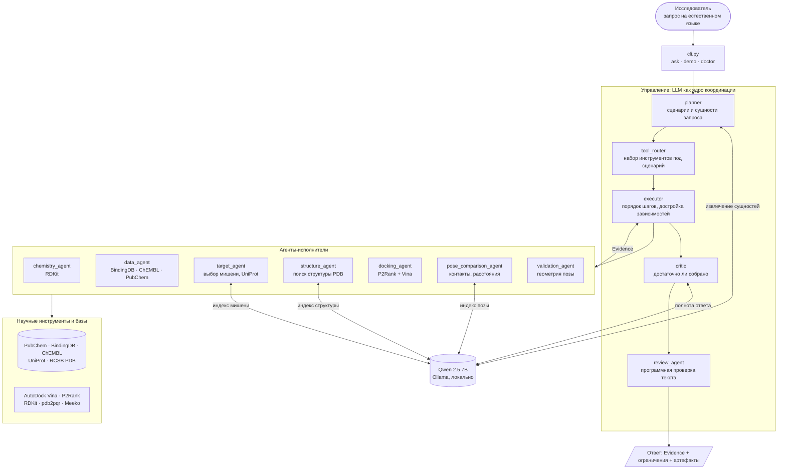
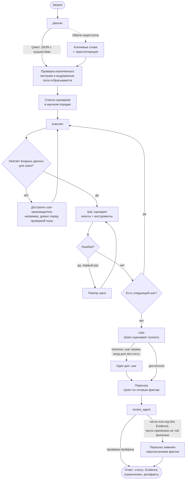
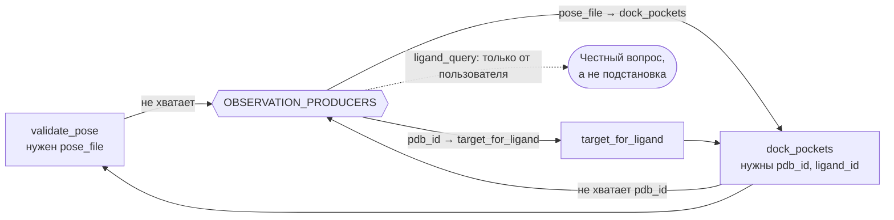
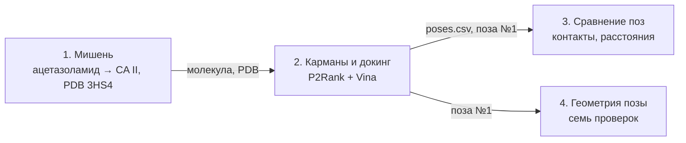
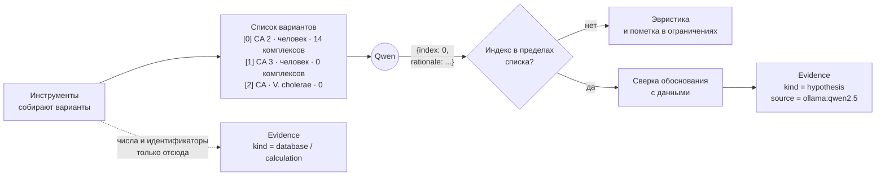
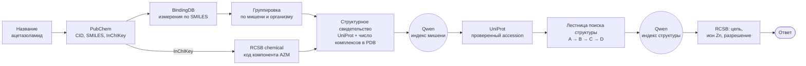
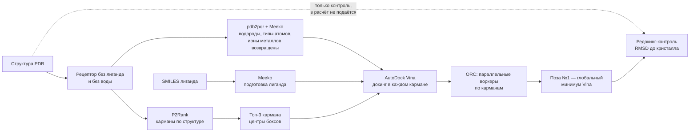
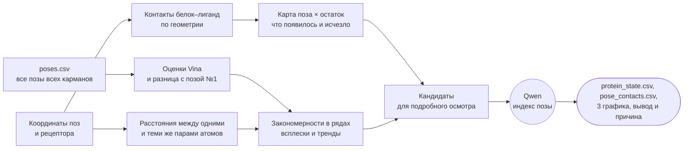

# DRUGDIS

**Мультиагентная система для дизайна лекарственных молекул.** Кейс №1 хакатона «ХИМБИО-ХАКАТОН СИНТЕЗ 2026» (ПИШ ИТМО).

Исследователь пишет запрос обычным языком. Локальная языковая модель (Qwen) разбирает его и управляет цепочкой агентов, а **все числа производят научные инструменты**: PubChem, BindingDB, UniProt, RCSB PDB, RDKit, P2Rank, AutoDock Vina. Каждое значение в ответе подписано происхождением: `database`, `calculation`, `prediction` или `hypothesis`. Система не показывает результатов, которых не получила.

> **Принцип, на котором держится всё остальное: LLM выбирает варианты, инструменты производят числа.**
> Модель возвращает только номер варианта из списка, собранного инструментами, и обоснование. Обоснование попадает в ответ как `hypothesis` с именем модели, а не как измерение.

```text
Запрос:  Подбери белок-мишень для ацетазоламида и обоснуй выбор экспериментальными данными.

Ответ:   Мишень: Carbonic anhydrase 2 (UniProt P00918), структура PDB 3HS4, цепь A, разрешение 1.1 Å,
         ион Zn, измеренная Ki 25 нМ, ссылка на запись BindingDB.
         Выбор подтверждён 14 кристаллическими комплексами белка с этим лигандом в PDB.
         Оговорка системы: измерение относится к мутантному варианту, дикого типа в выдаче нет.
```

## Содержание

1. [Запуск для проверки](#запуск-для-проверки)
2. [Архитектура](#архитектура)
3. [Оркестрация](#оркестрация)
4. [Как система не выдумывает результаты](#как-система-не-выдумывает-результаты)
5. [Четыре сценария](#четыре-сценария)
6. [Примеры работы](#примеры-работы)
7. [Валидация метода](#валидация-метода)
8. [Источники и инструменты](#источники-и-инструменты)
9. [Установка без Docker](#установка-без-docker)
10. [Тесты](#тесты)
11. [Структура репозитория](#структура-репозитория)
12. [Ограничения](#ограничения)
13. [Соответствие требованиям кейса](#соответствие-требованиям-кейса)

---

## Запуск для проверки

Самый быстрый способ развернуть и проверить систему — Docker Compose. Контейнер автоматически скачивает модель `qwen2.5:7b` в изолированный Ollama и собирает внешние бинарники.

### Вариант 1. Всё в контейнерах. Перед этим запустите контейнер Docker

```bash
git clone https://github.com/aaalinuxxx/DRUGDIS.git && cd DRUGDIS
docker compose up --build --abort-on-container-exit --exit-code-from drugdis
```

Что произойдёт:

1. поднимется Ollama;
2. скачается `qwen2.5:7b-instruct` (первый раз около 4.7 ГБ, дальше модель лежит в томе `ollama-models`);
3. приложение дождётся модели и выполнит все четыре сценария кейса одной цепочкой;
4. результаты (CSV, JSON, графики, отчёты) останутся на хосте в `outputs/`.

Если модель недоступна, контейнер **остановится с понятной ошибкой**.

| Что нужно | Минимум |
| --- | --- |
| Свободная RAM под Docker | 8 ГБ (Qwen 7B занимает около 6 ГБ). Для меньшего объёма: `OLLAMA_MODEL=qwen2.5:3b-instruct` |
| Диск | около 12 ГБ: образ приложения ~2 ГБ, образ Ollama ~3.4 ГБ, модель ~4.7 ГБ |
| Процессор | любой; на CPU один вызов Qwen занимает 10–60 с, полный прогон четырёх сценариев — несколько минут |
| Сеть | PubChem, RCSB, UniProt, BindingDB (на хосте с кешем `data/cache/` повторные запуски быстрее) |

### Вариант 2. Ollama уже стоит на хосте (Mac, видеокарта)

Контейнеры Docker Desktop на Mac не получают Metal-ускорение, поэтому модель удобнее держать на хосте:

```bash
ollama pull qwen2.5:7b-instruct
docker compose -f docker-compose.host-ollama.yml run --rm drugdis demo
```

### Вариант 3. Видеокарта NVIDIA

```bash
docker compose -f docker-compose.yml -f docker-compose.gpu.yml up --build \
    --abort-on-container-exit --exit-code-from drugdis
```

### Отдельные запросы и самопроверка

```bash
# проверка окружения: Python, RDKit, Vina, P2Rank, Java, Qwen, доступность баз
docker compose run --rm drugdis doctor

# то же плюс настоящий расчёт P2Rank и Vina на встроенной структуре (секунды, без сети)
docker compose run --rm drugdis doctor --deep

# любой собственный запрос
docker compose run --rm drugdis ask "Подбери белок-мишень для иматиниба и обоснуй выбор экспериментальными данными."

# тесты в контейнере
docker compose --profile test run --rm tests
```

---

## Архитектура



### Роли агентов

| Агент | Что делает | Использует LLM | Инструменты |
| --- | --- | :---: | --- |
| `planner` | Разбирает запрос: сценарии, молекула, PDB, пути к файлам. Русские названия переводит транслитерацией с проверкой по PubChem | да | Qwen, ключевые слова |
| `tool_router` | Выбирает инструменты. Qwen может добавить литературу, но не может убрать обязательный шаг | да | каталог инструментов |
| `chemistry_agent` | Структура молекулы, дескрипторы, фильтры | нет | PubChem, RDKit |
| `data_agent` | Измерения активности и литература | нет | BindingDB, ChEMBL, PubChem, RAG |
| `target_agent` | Выбор мишени по измерениям и структурам, accession UniProt | **индекс** | UniProt, RCSB |
| `structure_agent` | Поиск структуры уровнями A–D, цепи, кофакторы | **индекс** | RCSB Search и Data API |
| `docking_agent` | Карманы P2Rank, докинг Vina, контроль редокинга | нет | P2Rank, Vina, pdb2pqr, Meeko |
| `pocket_worker` | Один карман — один воркер, параллельная обработка | нет | ORC |
| `analysis_agent` | Сравнение карманов, тепловая карта | нет | matplotlib |
| `pose_comparison_agent` | Контакты белок–лиганд, расстояния, закономерности по позам | **индекс** | собственная геометрия |
| `validation_agent` | Семь геометрических проверок позы и вердикт | нет | RDKit, геометрия |
| `writer` | `report.md` только из готовых Evidence | нет | — |
| `critic` | Хватает ли собранного, нужен ли ещё шаг | да | Qwen |
| `review_agent` | Проверка текста ответа против Evidence | нет | программные правила |

Где LLM принимает решение, она выбирает **индекс в готовом списке**. Где её нет, система работает без модели вовсе.

---

## Оркестрация

### Цепочка одного запроса



### Достройка зависимостей

Исполнитель сверяет вход каждого шага со списком обязательных полей. Запрос «проверь позу эрлотиниба в 1M17» не падает с «укажите файл позы»: система сама добавляет докинг, потому что позу сперва надо посчитать.



Глубина достройки ограничена двумя уровнями. Добавленные шаги видны в трассе (`resolve:<поле>`) и в отчёте по сценариям. Карта «поле → производящий шаг» лежит в `OBSERVATION_PRODUCERS` ([orchestration/scenarios.py](orchestration/scenarios.py)); поля, которые может дать только пользователь, помечены `None`.

### Цепочка из четырёх сценариев

`python cli.py demo` выполняет сценарии как один диалог на одной молекуле: результат шага передаётся следующему, а передача видна в выводе.



---

## Как система не выдумывает результаты

Требование кейса — прозрачное разделение расчётов, предсказаний и гипотез и отсутствие выдуманных результатов. В DRUGDIS оно обеспечено **механизмом**, а не просьбой в промпте.

### Происхождение каждого значения

| `kind` | Что это | Пример |
| --- | --- | --- |
| `database` | Значение из внешней базы с датой получения и пометкой «живое/кеш» | Ki из BindingDB, accession из UniProt, разрешение из RCSB |
| `calculation` | Посчитано в этом запуске программой | оценка Vina, RMSD, дескрипторы RDKit, расстояния между атомами |
| `prediction` | Выход обученной модели машинного обучения | балл и ранг кармана P2Rank |
| `hypothesis` | Рассуждение языковой модели | обоснование выбора мишени |

### Граница LLM



Модель **не может**: придумать вариант (допустим только индекс), вернуть число, назвать UniProt-код или PDB ID (их резолвят UniProt и RCSB), выкинуть обязательный шаг маршрута.

### Что проверяет `review_agent`

Программа, без LLM, после того как текст написан:

1. каждое число в тексте существует среди Evidence;
2. **число привязано к своей величине**: если пересказ пишет «оценка Vina 2.5», а 2.5 — это IC50, проверка падает;
3. коды PDB и UniProt в тексте обязаны встречаться среди Evidence;
4. адреса записей, добавленные кодом, не считаются числами модели.

При провале пересказ заменяется перечислением фактов, **сами факты сохраняются**, а причина замены пишется в ограничения.

### Реально пойманные выдумки Qwen

Это не гипотетические угрозы: каждая из них зафиксирована при разработке на qwen2.5:7b-instruct и закрыта тестом.

| Что сделала модель | Чем это опасно | Чем поймано |
| --- | --- | --- |
| Планировщик извлёк мишень `ACO1_HUMAN` из запроса про ацетазоламид | ответ про чужой белок | подсказка не названа в запросе и не подтверждена измерениями, отброшена |
| Планировщик вписал «Carbonic anhydrase», и система ответила про *Vibrio cholerae* | подсказка «подтверждалась» измерениями бактериальных ортологов и подменяла выбор по данным | подсказка модели принимается только если слова есть в самом запросе |
| Написала «выбрана структура, содержащая запрошенный лиганд» там, где в карточке стоит «нет» | ложное обоснование выбора | обоснование сверяется с карточкой структуры и заменяется фактическим |
| Написала «наименьшая константа связывания (25 нМ)», когда у соседнего кандидата было 3.1 нМ | число настоящее, неверно сравнение | утверждение «сильнейшее связывание» сверяется с числами |
| Приписала молекулярную массу лиганда белку («масса белка 222.251 г/моль») | значение верное, величина не та | в сводке свойства лиганда помечены явно |
| Вписала UniProt-коды `Q03458`, `Q9H261`, `Q9H3G3` в сценариях, где мишени нет | несуществующие идентификаторы | `review_agent`: код без Evidence, пересказ заменён |
| Скопировала заглушку `X` из примера промпта как идентификатор лиганда | результаты докинга ложились в каталог `3HS4_x` | заглушки и слова, которых нет в запросе, отбрасываются |
| Вернула путь `path/to/universal_properties.csv` и затёрла им верный путь таблицы поз | сценарий сравнения поз оставался без данных | путь принимается только если файл существует |

Общая черта всех случаев: **числа настоящие, врёт привязка**. Поэтому проверка значений здесь недостаточна, и защита построена на сверке с данными.

---

## Четыре сценария

Запросы, ожидаемые ответы и фактические результаты каждого прогона генерируются командой `python cli.py demo` в [docs/scenarios.md](docs/scenarios.md) и [data/demo_requests.json](data/demo_requests.json) из реального запуска, поэтому разойтись с кодом не могут.

### 1. Подбор белка-мишени

> «Подбери белок-мишень для ацетазоламида и обоснуй выбор экспериментальными данными.»



Три решения принимаются **по данным, а не по памяти модели**:

- **Мишень.** Среди кандидатов BindingDB сильнее связывается карбоангидраза III, но кристаллических комплексов с ацетазоламидом у неё нет, а у карбоангидразы II их 14. Решает независимое свидетельство из PDB.
- **Accession.** Только из UniProt REST и только при совпадении имени. Не подтвердилось — мишень выводится без идентификатора и с оговоркой, а не по догадке модели. Слитые мишени (BCR-ABL) разводятся наличием кристалла с этим лигандом.
- **Структура.** Лестница из четырёх уровней, и **номер уровня попадает в ответ как факт**:

| Уровень | Смысл |
| :---: | --- |
| **A** | комплекс этого белка именно с этим лигандом (сопоставление по InChIKey) |
| **B** | структура этого белка с каким-то связанным лигандом (holo-форма кармана) |
| **C** | структура без лиганда (apo, геометрия кармана может отличаться) |
| **D** | полнотекстовый поиск: мишень не удалось сопоставить с UniProt |

### 2. Поиск карманов и докинг

> «Найди три наиболее перспективных кармана, проведи докинг в каждом и покажи лучшую позу по Vina.»



Докинг идёт **вслепую**: центры боксов берёт P2Rank по структуре без лиганда, координаты кристаллического лиганда в расчёт не подаются и служат только контролем (ранг найденного кармана, RMSD до кристалла). Если P2Rank нашёл меньше трёх карманов, список не дополняется выдуманными центрами, и это сказано в ограничениях. Провал контроля тоже говорится словами, а не остаётся голым числом.

### 3. Сравнение поз

> «Просмотри таблицу универсальных свойств белка, которую мы построили в докинге, и покажи, какие взаимодействия с белком меняются; найди интересные случаи…»



Все числа считает код по координатам. Модель получает готовый список кандидатов и возвращает индекс; вывод «какую позу проверить» строится детерминированными правилами. Проверяемость: у каждого расстояния на графике названы оба атома и файл позы, поэтому любое число сверяется вручную.

### 4. Геометрическая проверка позы №1

> «Проверь геометрию позы №1 и покажи, какие критерии она прошла.»

Семь проверок: столкновения белок–лиганд, длины связей, валентные углы, стереохимия, планарность колец, внутренние столкновения лиганда, координация иона металла. Вердикт считает **код по измерениям**, а не LLM по тексту:

- критическое столкновение отклоняет позу даже при четырёх пройденных проверках из пяти;
- проверка, которую не к чему применить (нет металла в кармане), не занижает процент;
- по каждой проверке показаны измеренное значение и порог.

---

## Примеры работы

Ниже — фактический результат полного прогона четырёх сценариев от **2026-11-12 21:55 UTC** (`python cli.py demo`). Это не описание намерений: те же поля лежат в [docs/scenarios.md](docs/scenarios.md) и [data/demo_requests.json](data/demo_requests.json) и перезаписываются следующим прогоном.

| Сценарий | Фактический результат | Откуда число |
| --- | --- | --- |
| Мишень для ацетазоламида | Carbonic anhydrase 2, UniProt **P00918**, PDB **3HS4**, цепь A, разрешение **1.1 Å**, ион **Zn**, Ki **25 нМ**. Подсказку модели «Carbonic anhydrase II» система не приняла: в запросе этой мишени нет. Обоснование «сильнейшее связывание» отклонено: среди кандидатов сильнее связывается другая мишень. Оговорка: измерение относится к мутанту, дикого типа в выдаче BindingDB нет | `database`: UniProt, RCSB PDB, BindingDB. Выбор модели — `hypothesis`, сверенный с карточками |
| Карманы и докинг в 3HS4 | Поза №1: Vina **−6.362 ккал/моль** (карман 1). Карман 2: **−6.278**. P2Rank нашёл **2 кармана из 3** — третьего центра система не выдумала. Контроль редокинга: поза №1 в **1.3 Å** от кристаллического AZM (порог 2 Å) | `calculation`: AutoDock Vina и RMSD. Балл кармана P2Rank — выход модели карманов. Докинг шёл вслепую: координаты кристалла в бокс не подавались |
| Сравнение поз | Разница с позой №1: **0.226 ккал/моль**. В одной из поз появился контакт **Asn62**, пропал **Gln92**. К подробному осмотру предложена **pocket1 / поза 8** | `calculation` по координатам поз. Индекс позы — `hypothesis` |
| Геометрия позы №1 | Вердикт: **поза принята**, **6 из 6** применимых проверок (**100 %**) | `calculation`, `pose_geometry` |

Файлы этого прогона (CSV, JSON, графики, `report.md`) контейнер пишет в `outputs/` на хосте: каталог хоста смонтирован в контейнер. Сохранённые прогоны для режима без живого докинга лежат в `data/examples/acetazolamide/` и `data/examples/3ptb_ben/`. Сводка бенчмарка редокинга — в [docs/redocking.md](docs/redocking.md).

---

## Валидация метода

Единственная честная метрика докинга — доля систем, где поза №1 лежит в пределах 2 Å от кристаллической. Бенчмарк прогоняет каждую систему **вслепую** (центры боксов от P2Rank, лиганд кристалла только для контроля) через тот же путь, что и сценарий 2:

```bash
make redock        # пишет docs/redocking.md
```

| Структура | Лиганд | Карман кристалла (ранг) | Vina поза №1, ккал/моль | RMSD поза №1, Å | Мин. RMSD среди 9 поз, Å | Поза №1 ≤ 2 Å |
| --- | --- | :---: | ---: | ---: | ---: | :---: |
| 3PTB | бензамидин | 1 | −5.89 | **0.37** | 0.30 | да |
| 3HS4 | ацетазоламид | 1 | −6.36 | **1.33** | 1.33 | да |
| 4WKQ | гефитиниб | 1 | −8.61 | 2.50 | 2.50 | нет (на границе) |
| 1M17 | эрлотиниб | 1 | −7.26 | 7.92 | 1.43 | нет |
| 2OIQ | иматиниб | 1 | −11.36 | 12.85 | 5.41 | нет |

**Итог: 2 из 5 систем.** Мы не подгоняли параметры, чтобы сделать его красивее.

Подробности и построчные результаты: [docs/redocking.md](docs/redocking.md).

Что стоит за таблицей, без украшений:

- карман кристаллического лиганда находится **в 5 из 5 случаев и всегда первым по рангу**: это заслуга P2Rank;
- с позой №1 справляются 2 системы из 5. Для гибких лигандов (эрлотиниб, иматиниб) Vina находит правильную позу среди девяти, но не ставит её первой: у эрлотиниба минимальный RMSD среди поз 1.43 Å при RMSD позы №1 7.92 Å. Это известное ограничение скоринговой функции Vina, и поэтому система показывает RMSD до кристалла как контроль, а не как гарантию;
- повышение `exhaustiveness` до 64 и смена зерна не меняли RMSD позы №1 у эрлотиниба (7.9 Å во всех шести пробных расчётах). В таблице стоят значения по умолчанию (`exhaustiveness=8`, бокс 22 Å): подбор параметров под результат не проводился;
- найденные при этом ошибки подготовки исправлены и закрыты тестами: рецептор шёл без водородов и с неверными типами атомов, а RMSD любого лиганда с хлором или бромом вообще не считался (тип `Cl` читался как `C`).

---

## Источники и инструменты

| Источник | Что берём | Как обращаемся | Если недоступен |
| --- | --- | --- | --- |
| PubChem PUG REST | CID, SMILES, InChIKey, аналоги | живой запрос + файловый кеш | сказано вслух, молекула не подменяется |
| BindingDB | Ki, Kd, IC50 по SMILES соединения | `getTargetByCompound` | сказано вслух |
| ChEMBL | активности по мишени или молекуле | живой запрос | **нестабилен (HTTP 500)**: сказано вслух, числа не подставляются |
| UniProt | accession по названию и организму | REST, `reviewed:true` сначала | мишень без идентификатора и с оговоркой |
| RCSB PDB | поиск структур, метаданные, цепи, кофакторы, число комплексов | Search и Data API | поиск уровнем ниже |
| P2Rank 2.5.1 | карманы по структуре белка | Java, процесс | докинг не выполняется, сказано вслух |
| AutoDock Vina 1.2.7 | позы и оценки | бинарник | расчёт не выполняется, сказано вслух |
| RDKit | дескрипторы, QED, геометрия | библиотека | ошибка, а не приблизительная оценка |
| pdb2pqr + Meeko | протонирование рецептора, типы атомов | процесс | откат на упрощённую подготовку **с явным предупреждением** |
| Qwen 2.5 7B (Ollama) | планирование, выбор из списка, пересказ | HTTP, локально | ключевые слова; в контейнере остановка с ошибкой |

В коде **нет** справочников молекул, SMILES, идентификаторов мишеней и «эталонных» активностей: это закреплено тестами `tests/test_no_hardcoded_chemistry.py`, которые сканируют исходники на SMILES-литералы. Предзагруженный срез в `data/external/` — это кеш реальных ответов баз для работы без сети, а не справочник в коде.

---

## Установка без Docker

```bash
python3 -m venv .venv && source .venv/bin/activate
python -m pip install -r requirements.txt        # версии зафиксированы
```

Бинарники кладутся в `tools/bin/` (каталог в `.gitignore`, сборки зависят от платформы) или задаются переменными:

```bash
export VINA_BIN=/путь/к/vina            # релизы: github.com/ccsb-scripps/AutoDock-Vina, проверено на 1.2.7
export P2RANK_BIN=/путь/к/p2rank/prank  # релизы: github.com/rdk/p2rank, проверено на 2.5.1, нужна Java 21
```

Языковая модель:

```bash
ollama pull qwen2.5:7b-instruct
export DRUGDIS_LLM_PROVIDER=ollama       # auto | ollama | keyword
```

Проверка и запуск:

```bash
python -m tools.doctor --deep            # самопроверка окружения
make scenario1                           # сценарий 1
make scenario2                           # сценарий 2
make demo                                # все четыре сценария, обновляет docs/scenarios.md
make demo-offline                        # без LLM, документацию не трогает
python cli.py ask "Подбери белок для докинга гефитиниба и предложи структуру из PDB"
```

Переменные окружения: `DRUGDIS_LLM_PROVIDER`, `OLLAMA_HOST`, `OLLAMA_MODEL`, `OLLAMA_TIMEOUT_S`, `VINA_BIN`, `P2RANK_BIN`, `DOCKING_LIVE` (`0` — брать сохранённый прогон только при точном совпадении структуры и лиганда), `ORC_MAX_POCKETS`.

---

## Тесты

```bash
make test                                # весь набор
docker compose --profile test run --rm tests
```

В `tests/` **215** функций `test_*` в **26** файлах. Контейнер для них не обязателен: контракт точки входа проверяет `tests/test_docker_entrypoint.py`, запуская `docker/entrypoint.sh` обычным shell. Живые тесты ходят в PubChem, BindingDB, UniProt и RCSB; без сети падают только они.

| Что закрывают | Файлы |
| --- | --- |
| Планирование, маршрут, сценарии | `test_planner_grounding.py`, `test_tool_router.py`, `test_scenarios.py`, `test_workflow_routes.py` |
| Мишень, структура, запрет выдуманных кодов | `test_target_identity.py`, `test_structure_composition.py`, `test_scenario1_bindingdb.py` |
| Докинг, подготовка рецептора, RMSD, ORC | `test_pocket_docking.py`, `test_receptor_prep.py`, `test_rmsd.py`, `test_vina_redock.py`, `test_live_docking.py`, `test_orc_parallel.py` |
| Сравнение и геометрия поз | `test_pose_comparison.py`, `test_pose_geometry.py`, `test_pose_validation.py` |
| Нет зашитой химии, контейнер не молчит без Qwen | `test_no_hardcoded_chemistry.py`, `test_docker_entrypoint.py` |

Тесты, которые стоит прочитать первыми, потому что они фиксируют обещания системы:

| Файл | Что гарантирует |
| --- | --- |
| `test_no_hardcoded_chemistry.py` | в коде нет молекул, SMILES и «эталонных» активностей |
| `test_target_identity.py` | выдуманная подсказка модели не подменяет выбор по данным; accession не угадывается |
| `test_planner_grounding.py` | заглушки и несуществующие пути от модели отбрасываются |
| `test_structure_composition.py` | ложное обоснование выбора заменяется фактическим; выдуманные коды PDB и UniProt ловятся |
| `test_receptor_prep.py` | вердикт редокинга говорится словами; сходящиеся подписи графика не зацикливают отрисовку |
| `test_rmsd.py` | RMSD с учётом симметрии; галогены читаются как галогены |
| `test_docker_entrypoint.py` | контейнер не подменяет Qwen молча; зависимости зафиксированы |

---

## Структура репозитория

```text
cli.py                       вход: ask, demo, compare, fetch-data
agents/                      роли: planner, target, data, structure, chemistry, docking,
                             analysis, pose_comparison, validation, review, writer
orchestration/               workflow, executor, сценарии, tool_router, ORC, клиент Ollama
tools/                       клиенты баз, обёртки Vina и P2Rank, RMSD, контакты, геометрия,
                             doctor, redock_benchmark, scenario_report
models/                      ResearchRequest, ResearchResult, Evidence, строки poses.csv
prompts/                     тексты промптов планировщика и маршрутизатора
data/external/               предзагруженный срез ответов баз (работа без сети)
data/examples/               сохранённые прогоны для режима DOCKING_LIVE=0
data/rag/                    короткие выдержки литературы
docker/                      entrypoint контейнера
docs/                        архитектура, сценарии (генерируются), редокинг-бенчмарк
tests/                       pytest
Dockerfile, docker-compose*.yml
```

Подробнее об устройстве: [docs/architecture.md](docs/architecture.md).

---

## Ограничения

Система называет их сама в поле `limitations` каждого ответа. Здесь собрано главное.

- **Метод.** Оценка Vina — расчётная величина, не экспериментальная аффинность. Редокинг: поза №1 в пределах 2 Å у 2 из 5 систем ([см. выше](#валидация-метода)).
- **Данные.** Для ацетазоламида в выдаче BindingDB REST нет дикого типа карбоангидразы II, только мутантный вариант. Система выбирает мишень по независимому свидетельству из PDB и пишет оговорку рядом с числом.
- **ChEMBL** периодически отвечает HTTP 500; активности из него в такие ответы не входят, и это сказано.
- **Литература.** RAG — несколько заранее сохранённых выдержек в `data/rag/`, а не поиск по статьям.
- **Подготовка молекул.** Нормализация таутомеров, солей и зарядов не выполняется; рецептор протонируется при pH 7.4 без оптимизации под конкретный лиганд.
- **Модель.** Qwen 7B на CPU медленная (10–60 с на вызов). Она склонна выдумывать привязку величин, поэтому ни одно её утверждение не попадает в ответ без программной сверки.
- **Клиническое.** Дескрипторы и докинг не позволяют делать выводы об эффективности, токсичности in vivo или безопасности; система отказывается от таких выводов явно.

---

## Соответствие требованиям кейса

| Требование | Где реализовано |
| --- | --- |
| Несколько взаимодействующих агентов с определёнными функциями | 14 ролей, [таблица](#роли-агентов) |
| LLM как ключевой компонент управления и взаимодействия | `planner`, `tool_router`, `target_agent`, `structure_agent`, `pose_comparison_agent`, `critic`: [оркестрация](#оркестрация) |
| Обработка запросов на естественном языке, координация агентов | планировщик, исполнитель, достройка зависимостей; русские названия молекул |
| Интеграция внешних научных инструментов и баз | PubChem, BindingDB, ChEMBL, UniProt, RCSB, P2Rank, Vina, RDKit: [источники](#источники-и-инструменты) |
| Не менее трёх сценариев «запрос → действия → ответ» | четыре сценария, [описание и факты](docs/scenarios.md) |
| Прозрачное разделение расчётов, предсказаний и гипотез | поле `kind` у каждого значения: [происхождение](#происхождение-каждого-значения) |
| Отсутствие выдуманных результатов | [граница LLM](#граница-llm) и `review_agent` |
| Архитектурная схема | [диаграммы выше](#архитектура) |
| Работающий прототип | `docker compose up --build`: [запуск](#запуск-для-проверки) |
| Описание сценариев с фактическим результатом | [docs/scenarios.md](docs/scenarios.md), генерируется из прогона |
| Репозиторий с инструкцией запуска | этот файл |

## Лицензия

MIT, см. [LICENSE](LICENSE).
